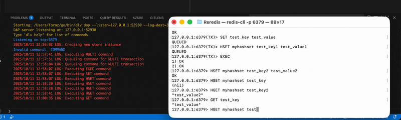

# Reredis

Redis if it was written in Go I guess?

## Features

- RESP protocol support (compatible with basic Redis clients)
- String, Hash, and List data structures
- Key expiration (with background cleanup)
- Basic transaction support (`MULTI`, `EXEC`, `DISCARD`)
- Concurrency using Go's goroutines and mutexes

## Getting Started

### Prerequisites

- Go 1.21+ (recommended 1.23+)
- (Optional) Docker

### Running Locally

```sh
go run main.go
```

The server listens on port `6379` by default.



### Using Docker

Build and run the Docker image:

```sh
docker build -t reredis .
docker run -p 6379:6379 reredis
```

## Supported Commands

- `PING`
- `SET key value [NX] [EX seconds] [EXAT timestamp]`
- `GET key`
- `DEL key [key ...]`
- `HSET hash field value`
- `HGET hash field`
- `HGETALL hash`
- `LPUSH list value [value ...]`
- `RPUSH list value [value ...]`
- `LPOP list`
- `RPOP list`
- `LLEN list`
- `LRANGE list start stop`
- Transactions: `MULTI`, `EXEC`, `DISCARD`

## TODO

- Implement SETS and ZSETS
- Write Ahead Log (AOF) for persistence 

## Example Usage

You can use the Redis CLI:

```sh
redis-cli -p 6379
127.0.0.1:6379> SET foo bar
OK
127.0.0.1:6379> GET foo
"bar"
127.0.0.1:6379> HSET myhash field1 value1
OK
127.0.0.1:6379> HGET myhash field1
"value1"
```

## Project Structure

```
pkg/
  handler/   # Command handlers
  resp/      # RESP protocol parsing/writing
  server/    # TCP server logic
  store/     # In-memory data store and types
  utils/     # Utility data structures (e.g., custom HashMap)
main.go      # Entry point
```

## Benchmarking

To run the benchmarks and see operations per second for core commands:

```
go test -bench=. -benchmem ./bench
```

This will output ops/sec for SET, GET, HSET, LPUSH, LPOP, and parallel SET operations.

BenchmarkSet-8            309259    3639 ns/op   120 B/op   5 allocs/op
BenchmarkGet-8            326234    3640 ns/op    95 B/op   4 allocs/op
BenchmarkHSet-8           363825    3633 ns/op   109 B/op   6 allocs/op
BenchmarkHGet-8           283737    3908 ns/op   192 B/op  11 allocs/op
BenchmarkParallelSet-8    262958    5058 ns/op   121 B/op   5 allocs/op

This in-memory key-value store achieves over 270,000 ops/sec for SET/GET/HSET/HGET on Apple M1, with low memory usage and allocation counts.